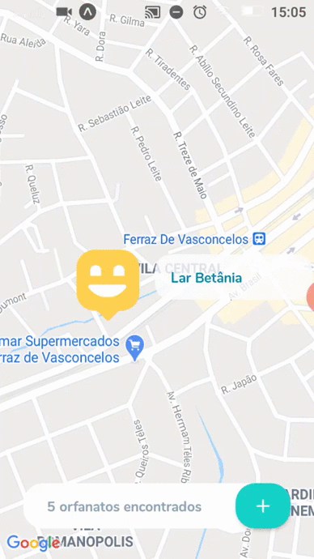

<p align="center">
  
</p>

<p align="center">
  
  
  <a href="https://rafaelfachinelli.com">
    
  </a>
  
</p>

<p align="center">
  <a href="#eye_speech_bubble-preview">Preview</a> •
  <a href="#information_source-about">About</a> •
  <a href="#memo-tasks">Tasks</a> •
  <a href="#arrow_forward-run">Run</a> •
  <a href="#hammer_and_wrench-technologies">Technologies</a> •
  <a href="#boy-author">Author</a> •
  <a href="#balance_scale-license">License</a>
</p>

---

## :eye_speech_bubble: Preview

<div align="center">

|Desktop|Mobile|
|:---:|:---:|
|<kbd></kbd>|<kbd></kbd>|

</div>

---

## :information_source: About

👶 Web platform, server and mobile app to register and find orphanages on the map of the Ferraz de Vasconcelos region, São Paulo, so people can visit them and brighten the children's day. Each orphanage has its location, photos, instructions and opening hours.

Built in 2020 during Rocketseat's Next Level Week #3 (Omnistack track), a one-week online event with practical challenges.

---

## :memo: Tasks

<div align="center">
<details>
<summary>Click to view</summary>

<details>
<summary>🌐 Web</summary>

|State|Task|
|:---:|:---|
|:heavy_check_mark:|Project structure with React|
|:heavy_check_mark:|Landing page|
|:heavy_check_mark:|Orphanages map with Leaflet|
|:heavy_check_mark:|Routes and navigation|
|:heavy_check_mark:|Reusable components|
|:heavy_check_mark:|Integration with the server|
|:heavy_check_mark:|Orphanage details|
|:heavy_check_mark:|Create an orphanage|

</details>

<details>
<summary>🗄️ Server</summary>

|State|Task|
|:---:|:---|
|:heavy_check_mark:|Node.js server structure|
|:heavy_check_mark:|Routes and parameters|
|:heavy_check_mark:|Database tables with TypeORM migrations|
|:heavy_check_mark:|Create and list orphanages|
|:heavy_check_mark:|Image upload with Multer|
|:heavy_check_mark:|Views (response formatting)|
|:heavy_check_mark:|Error handling|
|:heavy_check_mark:|Data validation with Yup|

</details>

<details>
<summary>📱 Mobile</summary>

|State|Task|
|:---:|:---|
|:heavy_check_mark:|Project structure with Expo|
|:heavy_check_mark:|Routes and navigation|
|:heavy_check_mark:|Components, pages and styles|
|:heavy_check_mark:|Map with react-native-maps|
|:heavy_check_mark:|Create an orphanage with photos|

</details>

</details>
</div>

---

## :arrow_forward: Run

You need [Node.js](https://nodejs.org/) and [Yarn](https://yarnpkg.com/). For the app, install [Expo Go](https://expo.dev/go) on your phone.

### Server

In the [`server/`](server/) folder:

```bash
# Install dependencies
yarn

# Create the SQLite database
yarn typeorm migration:run

# Start the server
yarn dev
```

> The server starts at <http://localhost:3333>.

### Web

In the [`web/`](web/) folder:

```bash
yarn
yarn start
```

> The app opens at <http://localhost:3000>.

### Mobile

In the [`mobile/`](mobile/) folder:

```bash
yarn
yarn start
```

> Scan the QR code with Expo Go.

---

## :hammer_and_wrench: Technologies

<div align="center">

|Web|Server|Mobile|
|:---:|:---:|:---:|
|[React](https://react.dev/)|[Node.js](https://nodejs.org/)|[React Native](https://reactnative.dev/)|
|[TypeScript](https://www.typescriptlang.org/)|[Express](https://expressjs.com/)|[Expo](https://expo.dev/)|
|[React Router](https://reactrouter.com/)|[TypeORM](https://typeorm.io/)|[React Navigation](https://reactnavigation.org/)|
|[Leaflet](https://leafletjs.com/)|[SQLite](https://www.sqlite.org/)|[React Native Maps](https://github.com/react-native-maps/react-native-maps)|
|[Axios](https://axios-http.com/)|[Multer](https://github.com/expressjs/multer)||
||[Yup](https://github.com/jquense/yup)||

</div>

---

## :boy: Author

<div align="center">

<a href="https://rafaelfachinelli.com">
  
  <br/>
  <sub><b>Rafael Fachinelli</b></sub>
</a>

Tech Lead and software engineer. Get in touch!

[](https://rafaelfachinelli.com)
[](https://www.linkedin.com/in/rafaelfachinelli/)
[](https://github.com/rafaelfachinelli)
[](mailto:rafael.l.a.fachinelli@gmail.com)

</div>

---

## :balance_scale: License

This project is under the [MIT license](./LICENSE).
